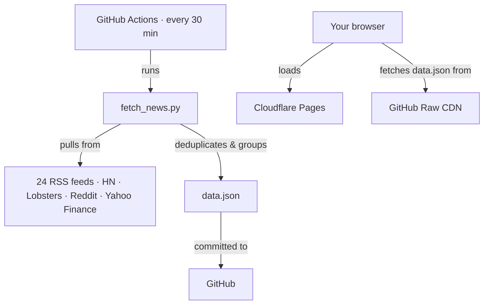

# 📰 The World State

A static, broadsheet-style news aggregator.

**[Live site →](https://news.nathankurien.com)**

---

## Why?

I've been finding it harder to find out what's going on in the world with current news sites and headlines. You end up reading one outlet's spin on a story instead of seeing the full picture.

The World State takes a different approach:

- **Consensus over bias.** Stories about the same event from BBC, Al Jazeera, France24, Straits Times, etc. are grouped into a single card. You see how widely something is being reported and can compare sources directly.
- **Signal over noise.** A print-newspaper layout. No infinite scroll, no recommended content, no engagement tricks.
- **Private by default.** Entirely static: no accounts, ads or custom trackers. Your browser fetches the page from Cloudflare Pages, the data from GitHub, and fonts from Google Fonts, and nothing else.

---

## How it works



**Backend:** A Python script fetches headlines from 24 global RSS feeds in parallel, plus Hacker News, Lobste.rs, five Reddit subs, financial tickers, and newsletter digests. It then groups duplicate stories and writes everything to a single `data.json`.

**Frontend:** One static HTML file. On load, client-side JS fetches `data.json` from the GitHub raw CDN (with a cache-buster), so Cloudflare Pages never needs to rebuild. Supports a dark "Night Edition" and escapes all rendered content against XSS.

### Story grouping

The deduplication pipeline is pure Python with no ML. Just text similarity:

One function, `titles_similar()`, decides whether two headlines are the same story. It is used both for grouping and for keeping Breaking and World from repeating each other, so the two can never disagree.

1. **Trigrams.** Headlines are normalised (lowercase, strip possessives/punctuation/stopwords) and compared via 3-word sliding windows. A story needs ≥2 matching trigrams to be grouped. Each group accumulates the trigrams of its members, so transitive chains (A≈B, B≈C → all grouped under A) work without one group stealing another's trigrams.

2. **Jaccard fallback.** Catches reworded headlines where the vocabulary is near-identical but word order differs. Threshold: ≥0.7.

3. **Overlap coefficient fallback.** Catches cases where one outlet writes a long headline and another writes a short one (big union tanks Jaccard). Threshold: ≥0.6 with ≥4 shared words to prevent false positives on short unrelated headlines.

Each outlet is counted once per story. `score` is the number of distinct outlets, shown on the card as "N sources".

### Ranking

Stories are ranked by `consensus`, not raw outlet count. Outlets are mapped to an ownership family and home region (`OUTLET_META`), so Euronews and Africanews count as one, and `consensus` = distinct families + 0.5 per extra region. A story reported across several continents outranks one picked up by three outlets in the same region. A story qualifies as Breaking with `consensus ≥ 2`, or if it is under 45 minutes old.

---

## Features

- **Breaking news panel.** Stories reported by independent outlets from the last 3 hours. Stays quiet when nothing major is happening.
- **Collapsible alternative sources.** Every grouped story has a dropdown listing all other outlets' versions with links and timestamps.
- **Markets section.** Delayed-quote financial ticker (indices, commodities, forex, equities) styled like a newspaper finance page.
- **Briefings & Digests.** Curated feeds from Politico Playbook, The Economist, Stratechery, and others.
- **Feed health.** `data.json` records whether each feed responded; the footer shows how many are reporting.
- **Source caps.** No single outlet can dominate the layout (max 2 breaking, 6 world per source).

---

## Local development

```bash
git clone git@github.com:nkurien/world-state-news.git
cd world-state-news

python -m venv .venv && source .venv/bin/activate
pip install -r requirements-dev.txt

# Compile a fresh data.json
python fetch_news.py

# Run tests and linters (the same checks CI runs)
python -m pytest -q
ruff check . && ruff format --check .
npm ci && npm run lint

# View the site
python -m http.server 8000
# → open http://localhost:8000
```

---

## License

Open source. Free to use.
